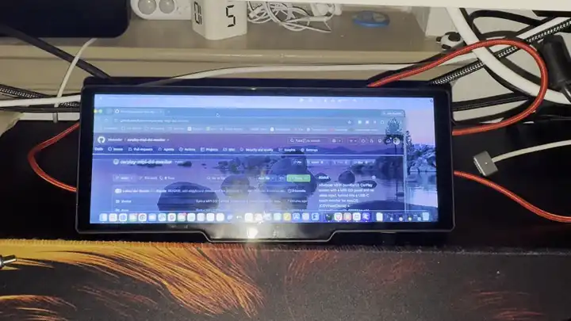

# CarPlay MIPI DSI screen → touch monitor for macOS



*Real speed (two clips joined, nothing sped up): a browser window dragged onto the screen, then scrolled with a finger.
[Longer video (53 s)](docs/media/demo.mp4): boot → desktop appears → drag → touch scrolling.*

An inexpensive aftermarket "CarPlay" car screen, re-flashed so that it works as a **real extended display for a Mac**,
with working **touch**.

**The catch:** the panel is a **MIPI DSI** display wired straight to the screen's SoC. There is no HDMI or any other
video input, so you can't simply plug it into a computer. Instead, the screen's own Linux SoC becomes the monitor:
the Mac renders a virtual display and streams it over USB-C, and the SoC paints it onto the DSI panel through its
framebuffer.

What you get:
- macOS sees it as a normal monitor ("V831 Display", 1600x600). You can drag windows onto it and arrange it in
  System Settings.
- The picture streams over the **USB-C cable** (USB network, ~10 MB/s). WiFi is the fallback, and it switches back automatically.
- Finger input becomes clicks, drags, long-press right-clicks and two-finger scrolling.
- Text is pixel-exact (lossless tiles). Scrolling runs at ~29 fps, typing at 14+ fps, and full-screen changes at ~10 fps.
- No HDMI input, no extra hardware, no app on the screen's original firmware: CarPlay is removed and replaced by a
  small custom client.

> ⚠️ **This is a hardware hack.** You will dump and reflash the device's SPI flash. Done wrong, it can brick the
> screen (recoverable over USB FEL if you kept a full backup). It uses a private macOS API that Apple may change at any
> time. No affiliation with Apple; "CarPlay" is a trademark of Apple Inc. and is used only to describe the hardware.

## How it works (short version)
```
 Mac                                                     Screen (Allwinner V831, Linux)
 vdisplay ── creates a virtual display (CGVirtualDisplay)
         ── captures it (ScreenCaptureKit, dirty rects)
         ── sends only changed tiles: raw / lossless / JPEG / "move block" (scroll)
                         ── TCP over USB-C (CDC-NCM) or WiFi ──▶  vdclient ── draws into /dev/fb0
         ◀── touch contacts ─────────────────────────────────────  GT911 touch
         └─ turns them into mouse events (CGEvent)
 dashd.py ◀── board polls for shell commands every 3 s (remote maintenance, no reflash needed)
```
Full explanation: **[docs/ARCHITECTURE.md](docs/ARCHITECTURE.md)**.

## Problems this solves
- Using a **car CarPlay / Android Auto screen as a second monitor** for a Mac (or as a "mini display" / touch bar).
- A **MIPI DSI panel with no HDMI input**: driving it from a computer without a DSI bridge board.
- Reusing a cheap **Allwinner V831 / sun8iw19** device: dumping, unpacking and re-flashing its SPI NOR firmware,
  including the vendor-modified squashfs, and **software FEL** entry so the case can stay closed.
- A **USB-C network link (CDC-NCM gadget)** from an embedded Linux board to macOS with no driver.
- **macOS virtual display + touch**: `CGVirtualDisplay` + ScreenCaptureKit streaming, with GT911 touch mapped to
  clicks, drags, right-clicks and scrolling.

## Chip and board details
| Part | Detail |
|---|---|
| SoC | **Allwinner V831** (sun8iw19p1), single **ARM Cortex-A7** @ 1 GHz, NEON, G2D 2D engine |
| RAM | 128 MB (~122 MB visible to Linux, ~86 MB free while running) |
| Storage | 16 MB **SPI NOR** flash (boot0 + U-Boot, kernel, squashfs rootfs, 512 KB jffs2 overlay) |
| OS | Allwinner **Tina Linux** (OpenWrt-based), kernel **4.9.118**, BusyBox |
| Display | **MIPI DSI**, 4 lanes, RGB888, 600x1600 portrait panel; `/dev/fb0` is 1600x600 BGRA, rotated by G2D |
| Touch | **Goodix GT911** capacitive, I2C bus 3 @ 0x5d, driver `gt9xxnew_ts`, multitouch protocol A |
| WiFi | **AP6334** module (Broadcom **BCM4334**), `bcmdhd` driver, station mode |
| USB | USB-C **OTG** (sunxi `usbc0`, UDC `5100000.udc-controller`), used as a configfs **CDC-NCM** gadget |
| Flashing | **FEL** mode via [xfel](https://github.com/xboot/xfel): hardware (flash CLK→GND) or software (RTC GPR2 magic `0x5AA5A55A`) |
| Stock software | `sdvcam` / `lylinkapp` (wireless CarPlay + Android Auto), removed by `strip.sh` |

## Hardware
Tested on a 10.26" 1600x600 "wireless CarPlay / Android Auto" screen built around an **Allwinner V831**
(sun8iw19p1: one Cortex-A7 at 1 GHz, 128 MB RAM, 16 MB SPI NOR, AP6334 WiFi, GT911 touch, USB-C OTG) with a
4-lane MIPI DSI 600x1600 panel, running
Allwinner's Tina Linux 4.9. Other V831/V833 screens may be similar, but offsets, drivers and the touch controller
can differ. See [docs/HARDWARE.md](docs/HARDWARE.md) and check everything against your own unit.

## Repository
| Path | What |
|---|---|
| `mac/vdisplay.swift` | Mac daemon: virtual display, capture, tile encoder, scroll detection, touch → mouse |
| `mac/start.command`, `stop.command`, `run_vdisplay.sh`, `make_launchers.sh` | Start/stop, supervisor, `.app` launchers |
| `device/vdclient.c` | Board display client (static armv7: libjpeg-turbo + zlib) |
| `device/httpc.c` | Tiny HTTP client the board uses for the command channel |
| `device/usbnet.sh` | Makes the USB-C port a CDC-NCM network adapter + one-lease DHCP for the Mac |
| `overlay/` | Files baked into the firmware (init script, boot script, config example) |
| `server/dashd.py` | Command server on the Mac (`/cmd`, `/result`, `/files`, `/upload`) |
| `build.sh`, `strip.sh`, `tools/Dockerfile` | Rebuild the rootfs from your own dump (patched squashfs-tools) |
| `flash.sh`, `remote_flash.sh` | Flash over FEL, including a "software FEL" trigger with the case closed |
| `device/evinject.c`, `pantest.c`, `i2cscan.c`, `devmem.c`, `mac/helpers/` | Test and debug tools |
| `docs/` | Architecture, operations runbook, hardware, protocol, history and lessons, edge cases, research |

## Getting started
Requirements: a Mac on Apple Silicon (built and tested on macOS 27.0.1), Xcode command line tools, Docker
Desktop, [xfel](https://github.com/xboot/xfel), and the screen connected to the Mac with a data-capable USB-C cable.

1. **Back up the whole flash first.** Put the board in FEL (short the SPI flash CLK pin to GND at power-on), then run
   `xfel spinor read 0 0x1000000 backup.bin`. Keep this file safe and read-only: it is your only way back to stock.
2. `cp config.env.example config.env` and fill it in (Mac and board WiFi IPs, xfel path, backup path).
3. `cp overlay/etc/dashboard.conf.example overlay/etc/dashboard.conf` and set your WiFi SSID/password and the Mac's IP.
4. Build:
   ```sh
   docker build -t carplay-sqfs tools
   device/build.sh          # board binaries → overlay/usr/bin
   ./build.sh               # → build/rootfs_roundtrip.sqsh, rootfs_dash.sqsh, rootfs_min.sqsh
   mac/build.sh             # Mac daemon + helpers
   ```
5. Flash `build/rootfs_roundtrip.sqsh` first (an unmodified repack) and confirm the device still boots. Then flash
   `build/rootfs_min.sqsh` with `./flash.sh` (board in FEL). After that, `./remote_flash.sh` can reflash with the
   case closed.
6. On the Mac, run `mac/start.command` from **Terminal**. Grant Terminal **Screen Recording** and **Accessibility**
   when asked. Optionally run `mac/make_launchers.sh` and add `CarPlay Monitor.app` to Login Items.

Day-to-day commands, remote maintenance and recovery: **[docs/OPERATIONS.md](docs/OPERATIONS.md)**.

## Status and limitations
Works daily. Known limits are listed in [docs/EDGE_CASES.md](docs/EDGE_CASES.md). The main ones:
- Video plays at ~10 fps; the 1 GHz CPU's decode speed is the limit.
- The display exists only while the screen is connected, so it can't be your only monitor.
- The command channel has no authentication. Use it only on a trusted home network.
- It depends on the private `CGVirtualDisplay` API.

## How it was built
Built in about two days with an AI coding agent (Claude Code) doing the reverse engineering, firmware work and code,
with a human handling the hardware. The full story, including every mistake and what it taught, is in
[docs/HISTORY.md](docs/HISTORY.md).

## License
MIT, see [LICENSE](LICENSE). Covers the code in this repository only, not the device's vendor firmware.
